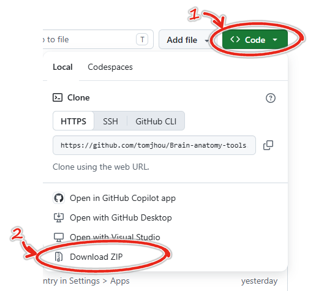
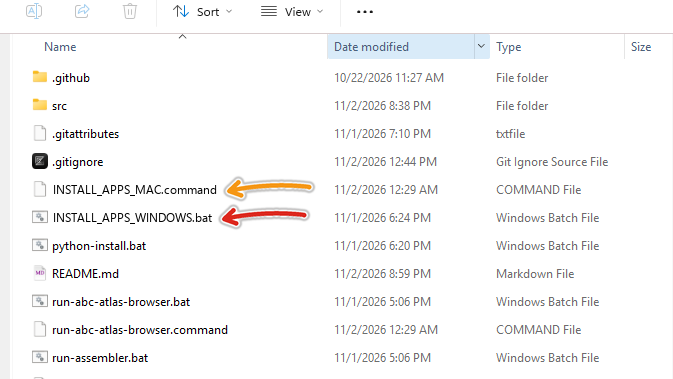
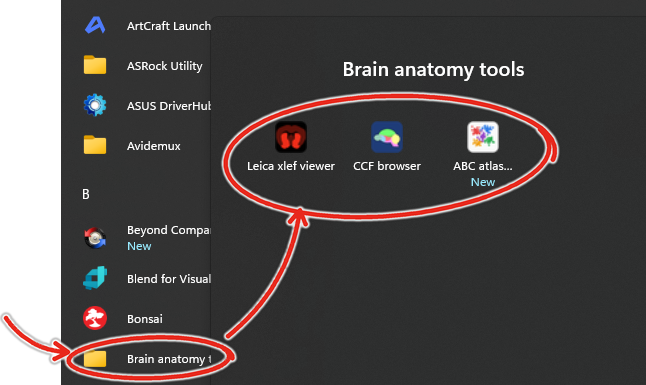
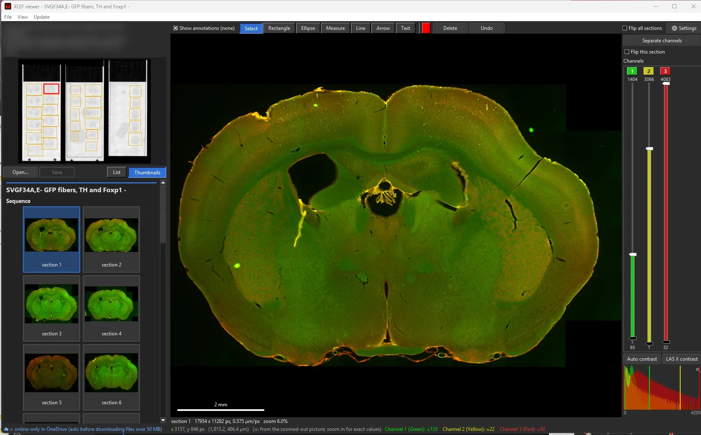
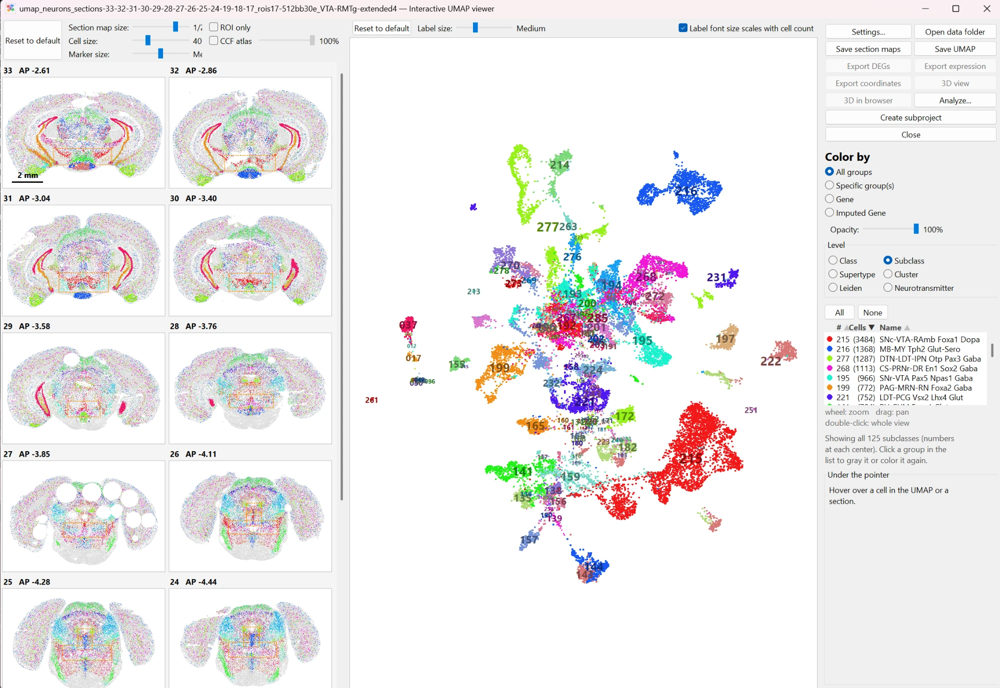
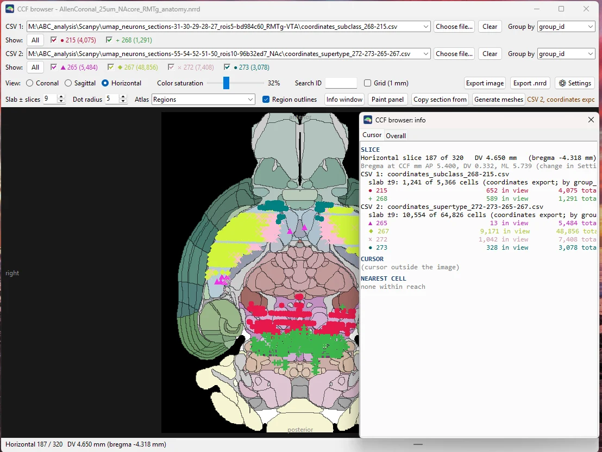
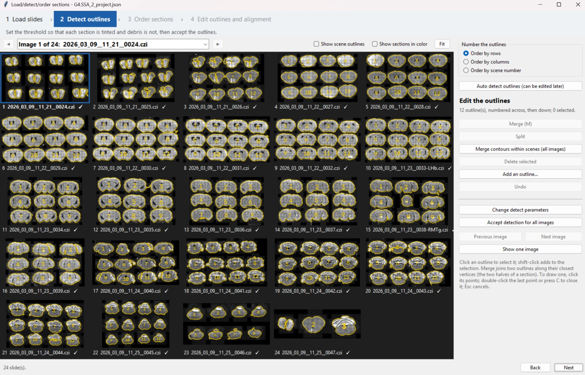

# Brain Anatomy Tools

This repository has several tools for analyzing brain anatomy data.

The fastest way to get started is to click the green "CODE" button above, then click "Download ZIP".

Unzip the download, then double click `INSTALL_APPS_WINDOWS.bat` on Windows (red arrow below), or `INSTALL_APPS_MAC.command` on Mac (orange arrow).

You should see 4 new apps in the Windows Start Menu (or Mac Applications folder):

Run the apps like you would any normal Windows or Mac app.

The first time each app starts, it sets itself up: it installs Python if the computer has none, and downloads the libraries it needs into
this folder. This takes a few minutes and needs an internet connection, and it leaves any Python you already have alone. Later starts are quick.

**On a Mac**, install Python 3.13 from [python.org](https://www.python.org/downloads/) first. The first time you open
`INSTALL_APPS_MAC.command`, right-click it and choose Open: macOS asks before running a script it hasn't seen before.

**Windows may warn** "Windows protected your PC" the first time you run one of the stand-alone `.exe` programs below, because they are not code-signed: choose More info, then Run anyway.

### Updating and uninstalling

- **Update:** in the xlef viewer, choose Update > Update from GitHub. It shows what's new and updates all tools at once.
- **Uninstall:** Windows Settings > Apps > "Brain anatomy tools", or double-click `UNINSTALL_APPS_WINDOWS.bat` (`UNINSTALL_APPS_MAC.command` on a
  Mac). It asks before removing anything large, and never touches your images, projects or results.

Most buttons and controls explain themselves when you hover the mouse over them.

## 1. XLEF viewer

A fast viewer and organizer for Leica LAS X experiments (`.xlef` projects, and `.lif` files):

- **Open experiments quickly**, even large ones on a network drive or in OneDrive: it reads only what is needed for the current view.
  It uses LAS X's reduced-size copies of the images (pyramids) when there are some, and can make them for experiments that have none.
- **See every image** in the experiment as a list or as thumbnails, and zoom from the whole slide down to single pixels.
- **View the channels** overlaid in their LAS X colors, or side by side. Adjust each channel's brightness and contrast (with
  a histogram) and its color.
- **Annotate**: see the measuring lines, arrows, shapes and text added in LAS X, and add or edit your own.
- **Organize**: rename images and folders, put them in a different order, move them to another experiment, or delete them.
- **Save back into LAS X's own files**, so LAS X shows the same changes. A backup of each changed file is kept. Close the experiment in
  LAS X before saving. (`.lif` files are read only.)

To open an experiment, use File > Open, or drag its `.xlef` file onto the window.

## 2. Allen ABC atlas browser

Explore the Allen Brain Cell (ABC) atlas, a map of millions of individually identified cells in the mouse brain (the MERFISH dataset
C57BL6J-638850):

- Pick brain sections and regions of interest.
- Compute a UMAP of the selected cells, and see it beside maps of the sections.
- Color the cells by cell type (at any level of the atlas' taxonomy) or by the expression of any gene, including the imputed genes.
- Export the cells' coordinates, e.g. to plot them in the CCF browser.

The first time, it asks where to keep the atlas download. Choose a drive with plenty of room: the download can reach about 80 GB (9 GB for the core atlas, 50 GB for the imputed gene dataset, and room for newer atlas releases).
The browser shows its progress, and now and then asks a question, in a text window beside its own: keep that window visible.

There is also a stand-alone Windows version, with nothing to install:
[ABCAtlasBrowser-1.0.0-windows.zip](https://github.com/tomjhou/Brain-anatomy-tools/releases/download/atlas-v1.0.0/ABCAtlasBrowser-1.0.0-windows.zip)
(about 290 MB; newer versions will be on the [Releases](https://github.com/tomjhou/Brain-anatomy-tools/releases) page). Unzip it
anywhere and run `ABCAtlasBrowser\ABCAtlasBrowser.exe`.

## 3. CCF browser

Browse the Allen Common Coordinate Framework (CCF), the standard 3D atlas of the mouse brain, in coronal, sagittal or horizontal
slices, and plot cells on it:

- cells exported from the ABC atlas browser, or markers exported from NeuroInfo (as CSV files);
- 3D surfaces of brain regions.

It downloads the atlas it needs on first use, after asking.

## 4. Brain section assembler

This program augments the "Serial Section Assembler" of MBF's NeuroInfo program by allowing you to
re-edit image stacks after they are made. It can replace NeuroInfo's entire workflow (detection, ordering,
and aligning) for Zeiss .czi or jp2 input images. It is also faster, friendlier, and less buggy.

It is in the Start menu (or Applications folder) with the other apps. There is also a stand-alone Windows version, with nothing to
install: download
[SectionAssembler-windows.zip](https://github.com/tomjhou/Brain-anatomy-tools/releases/latest/download/SectionAssembler-windows.zip)
(always the newest version), unzip it anywhere, and run `SectionAssembler\SectionAssembler.exe`. To update the stand-alone version,
download it again.

<b>Technical details</b> (for developers; most users don't need any of this)

### What is where

- The `.bat` files (and their Mac `.command` twins) at the top start the tools. The programs themselves, and everything they use, are in `src/`.
- The first `.bat` run finds Python (installing Python 3.13 for this user if there is none) and builds a private environment, `.venv`,
  in this folder (`.venv-macos` on a Mac, so that a folder shared with Windows can keep both). All the tools share it. It is about 300 MB,
  and grows to about 1.1 GB once the ABC browser has installed its libraries.
- `INSTALL_APPS_WINDOWS.bat` and `INSTALL_APPS_MAC.command` make the shortcuts (Windows: desktop and Start menu, and an entry in Settings > Apps; Mac: apps in `~/Applications`).
  Run it again after moving this folder. The icons are drawn by `src/icons/make_icons.py`.
- The xlef viewer and CCF browser run without a console window; their output goes to `%LOCALAPPDATA%\JhouLab\logs`
  (`~/Library/Logs/JhouLab` on a Mac), and errors are shown in a message box.
- Updating: a git clone updates with git. A folder unzipped from GitHub knows its version from `src/version.txt`, which GitHub fills in
  when it makes the ZIP; see `src/app_update.py`.

### Running from the source in your own Python

Install Python and run, e.g., `python src/ABC_atlas_browser.py` from your environment (e.g. after `conda activate <env>`): at startup
it checks for missing libraries and installs them into that environment.

### Data locations

- **ABC atlas download:** from the source, the browser first looks for `abc_atlas_cache` beside this folder; if there is none, it asks
  where to put it (or where an existing download is). The choice is saved in `src/cache_local/abc_atlas_cache_location.json`; delete
  that file to be asked again.
- **Caches and settings:** `src/cache_local` and `src/viewer_settings.json` (regenerated as needed). The stand-alone ABC browser keeps
  them in `%LOCALAPPDATA%\JhouLab\ABCAtlasBrowser\program`. The xlef viewer's settings are in `~/.xlef_viewer_settings.json`, and its
  thumbnails in `%LOCALAPPDATA%\JhouLab\xlef_viewer_thumbs`.

### Building the stand-alone programs

See `src/packaging/README.md`.

